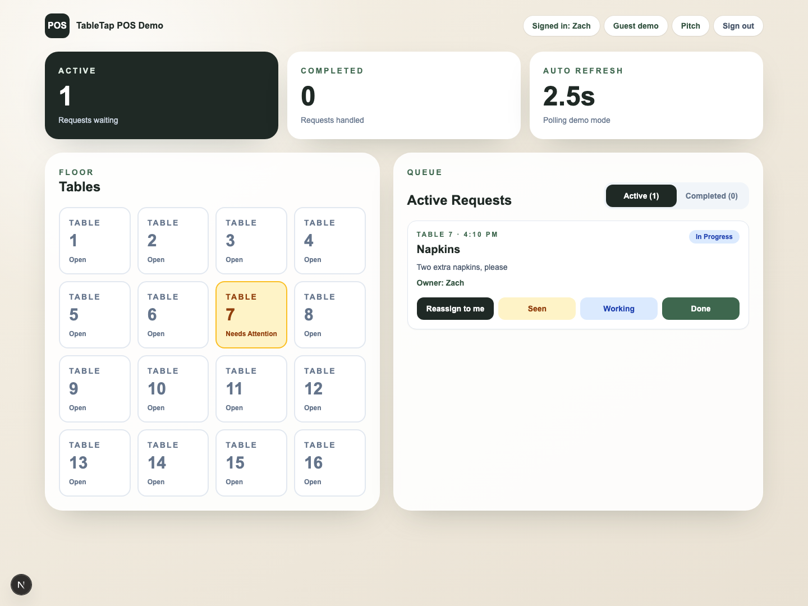
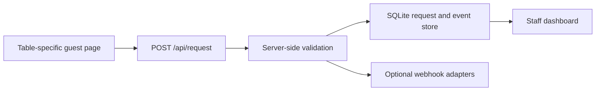

# TableTap Restaurant Service Request MVP

TableTap is a mobile-first restaurant service-request prototype. Guests open a
table-specific page through a QR code, submit a routine request, and staff claim
and track it in a mock POS queue. The concept and operating requirements draw on
firsthand restaurant-service experience and two server interviews.

**Status:** Working local MVP with SQLite persistence, named request ownership,
event history, PIN-protected staff sessions, restaurant-scoped queues, and
optional webhook delivery. It is not a production restaurant system or a
verified Toast integration.



[Read the consulting case study](docs/case-study/Zach_Fogle_TableTap_Consulting_Case_Study.pdf)
or use the [employee walkthrough guide](docs/EMPLOYEE_WALKTHROUGH.md).

## Problem

Routine needs such as refills, napkins, or the check can be difficult to surface
while staff are busy. TableTap tests whether an optional digital channel can make
those requests visible without replacing personal service or creating unclear
responsibility.

## Current capabilities

- Dynamic, QR-friendly guest pages at `/table/[tableId]`
- Mobile request buttons, optional notes, validation, and submission feedback
- Staff dashboard with active and completed queues
- Signed, eight-hour staff sessions protected by a restaurant PIN
- Restaurant-scoped queue reads and updates
- Named request ownership with claim and reassignment controls
- SQLite persistence for requests, assignments, completion times, and event history
- Version checks that reject updates from stale queue snapshots
- Optional Discord, generic POS, and Toast-bridge delivery adapters
- Nine automated tests covering request delivery and persistent workflow behavior

## Architecture

TypeScript, Next.js App Router, React, Tailwind CSS, and Node SQLite.



- `app/table/[tableId]/page.tsx`: dynamic guest pages
- `app/api/request/route.ts`: request validation and delivery
- `components/request-panel.tsx`: guest workflow
- `lib/mock-pos-store.ts`: SQLite request and event repository
- `app/pos/` and `components/pos-dashboard.tsx`: staff queue and table views
- `lib/integrations/`: mock POS, Discord, and optional bridge adapters

## Run locally

Use Node.js 22 or newer and npm. Node 22 is required for the built-in SQLite API.

```bash
npm install
cp .env.example .env.local
npm run dev
```

For a local mock-only demo, leave `DISCORD_WEBHOOK_URL=` and keep
`MOCK_POS_ENABLED=true`. Requests are stored in `.data/tabletap.db` unless
`TABLETAP_DB_PATH` specifies another file. Set a long random
`TABLETAP_AUTH_SECRET`, a staff PIN, and a restaurant ID before opening the queue.

## Walk through the demo

1. Open <http://localhost:3000/table/7>.
2. Open <http://localhost:3000/pos/login> and sign in with a staff name and PIN.
3. Submit a request and confirm that it appears in the restaurant's staff queue.
4. Claim the request with the signed-in staff identity.
5. Move it through Seen, In Progress, and Done.
6. Restart the application and confirm that the request and history remain.

## Configuration

```dotenv
DISCORD_WEBHOOK_URL=
RESTAURANT_TIME_ZONE=America/New_York
MOCK_POS_ENABLED=true
TABLETAP_DB_PATH=.data/tabletap.db
TABLETAP_AUTH_SECRET=replace-with-at-least-32-random-characters
TABLETAP_STAFF_PIN=2468
TABLETAP_RESTAURANT_ID=demo-restaurant

POS_WEBHOOK_URL=
POS_WEBHOOK_SECRET=

TOAST_BRIDGE_WEBHOOK_URL=
TOAST_BRIDGE_SECRET=
TOAST_RESTAURANT_EXTERNAL_ID=
TOAST_LOCATION_NAME=
```

Keep real secrets in `.env.local`. Do not commit that file.

## Integrations

Discord delivery is optional through `DISCORD_WEBHOOK_URL`. Generic POS delivery
uses `POS_WEBHOOK_URL` and optionally `POS_WEBHOOK_SECRET`.

The Toast adapter sends a structured payload to a separately hosted bridge. This
repository does not implement direct Toast order creation or include a working
Toast integration service. See [the integration plan](docs/TOAST_INTEGRATION.md).

## Quality checks

```bash
npm run lint
npm test
npm run build -- --webpack
```

## Current limitations

- The shared PIN is suitable for a controlled demonstration, but production use needs individual identities and managed access.
- Local SQLite storage is not shared across serverless application instances.
- There is no queue-coverage state, intake pause, or escalation policy.
- Table IDs are URL-based and are not mapped to Toast table GUIDs.
- No payments or direct Toast order creation are implemented.
- Service-time and staff-effort improvements have not been measured in a live pilot.

## Next steps

1. Run a structured employee walkthrough and record usability findings.
2. Replace the shared PIN with managed individual staff identities.
3. Move the repository to a managed database before shared deployment.
4. Add queue capacity controls and a documented fallback process.
5. Confirm the restaurant's supported POS integration path.

The [manager pitch and pilot plan](docs/GM_PITCH.md) describes the proposed
evaluation. It does not represent a completed restaurant pilot.
